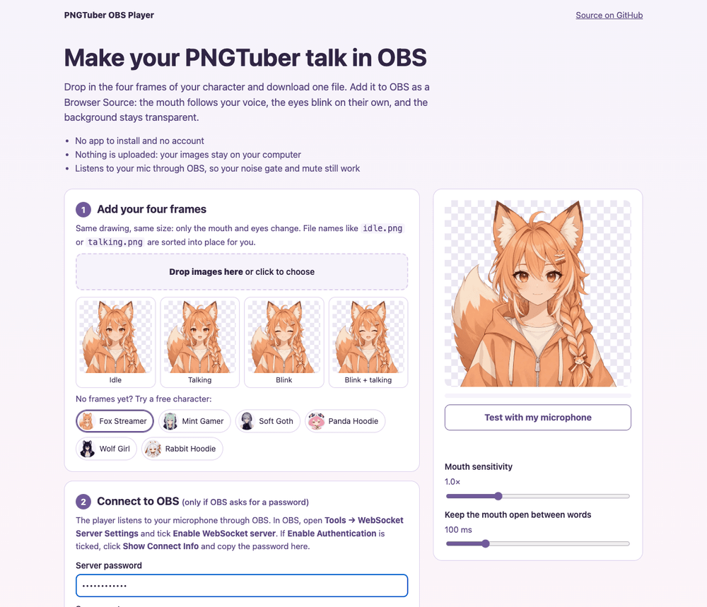

# PNGTuber OBS Player

Make your PNGTuber talk in OBS without installing anything. Drop in the four
frames of your character, download one HTML file, and add it to OBS as a
Browser Source. The mouth follows your voice, the eyes blink on their own, and
the background stays transparent.

**Use it here: https://pngtubermaker.github.io/pngtuber-obs-player/**



## What you need

- **OBS Studio 28 or newer.** It has the WebSocket server built in.
- **Four PNG frames of the same character, all the same size, with a
  transparent background:**

  | Frame | Mouth | Eyes |
  |---|---|---|
  | `idle.png` | closed | open |
  | `talking.png` | open | open |
  | `blink.png` | closed | closed |
  | `blink-talking.png` | open | closed |

  Only `idle` is required; a missing frame is replaced by the nearest one.
  File names like these are sorted into place automatically.

No frames yet? The page has six free sample characters you can use right
away.

## Add it to OBS

1. In OBS, open **Tools → WebSocket Server Settings** and tick **Enable
   WebSocket server**. If **Enable Authentication** is ticked, click **Show
   Connect Info** and copy the password into the setup page before you
   download.
2. Click **+** under **Sources**, choose **Browser**, tick **Local file** and
   pick the downloaded file.
3. Set **Width** and **Height** to your frame size, then click **OK**.
4. Talk. If the mouth doesn't move, a short note on the source says what OBS
   needs; it disappears once the mouth has moved.

For a second expression (angry, happy…), make another file from those frames
and switch between the two sources with OBS's show and hide hotkeys.

## How it works

OBS's browser source blocks the microphone unless OBS was started with
`--enable-media-stream`. It can always reach `127.0.0.1`, though, so the
player connects to OBS's own WebSocket server (v5) and listens to the
`InputVolumeMeters` event for your microphone source: Mic/Aux, or the first
Audio Input Capture if Mic/Aux is off. That level comes after OBS's filters,
fader and mute, so a noise gate keeps working and muting your mic keeps the
mouth shut. If OBS can't be reached, the player falls back to the browser
microphone.

- The mouth opens the moment your level crosses a threshold and closes after
  it has stayed below for a short hold (100 ms by default), so it doesn't flap
  shut between syllables.
- The eyes blink for 170 ms every 2.4–5 seconds, independent of your voice.
- The downloaded file holds your images (as WebP, at most 1024 px), your
  settings and, if you entered one, your OBS WebSocket password. Nothing is
  uploaded anywhere. Keep the file to yourself if it contains a password.

**Streamlabs Desktop** has no OBS WebSocket server, so the character shows
up there but doesn't talk.

## Development

No build step and no dependencies. `player.js` is the player, used both by
the setup page and inlined into every downloaded file. `app.js` is the setup
page.

```sh
python3 -m http.server 8000   # then open http://localhost:8000
node --test                   # unit tests for the pure parts
```

The page has to be served over HTTP (not opened as a file) because it reads
`player.js` to build the download.

## Sample characters

The six characters in `samples/` come from the
[Free AI PNGTuber Pack](https://pngtubermaker.itch.io/free-ai-pngtuber-pack)
and were generated by AI with [PNGTuber Maker](https://pngtubermaker.net/).
They are free to use however you like, including on monetized Twitch and
YouTube channels, with no credit required. They are not covered by the MIT
License below.

## Need a character?

[PNGTuber Maker](https://pngtubermaker.net/) is an AI PNGTuber generator:
describe a character or upload a reference image, pick one of four designs,
and get the four frames this player needs.

## License

The code is MIT licensed: see [LICENSE](LICENSE).
